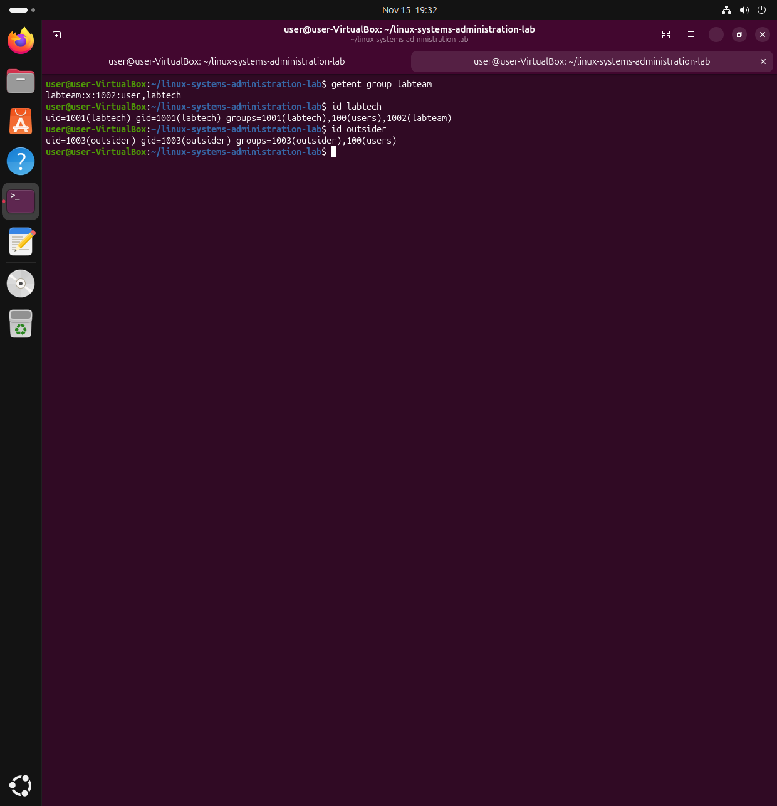
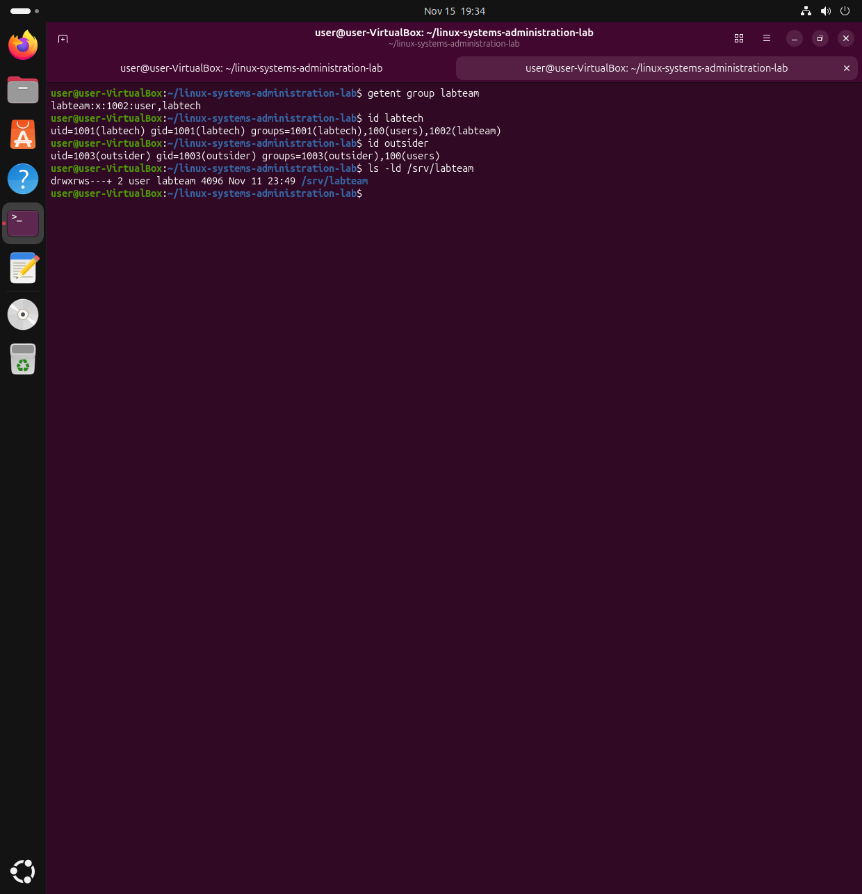
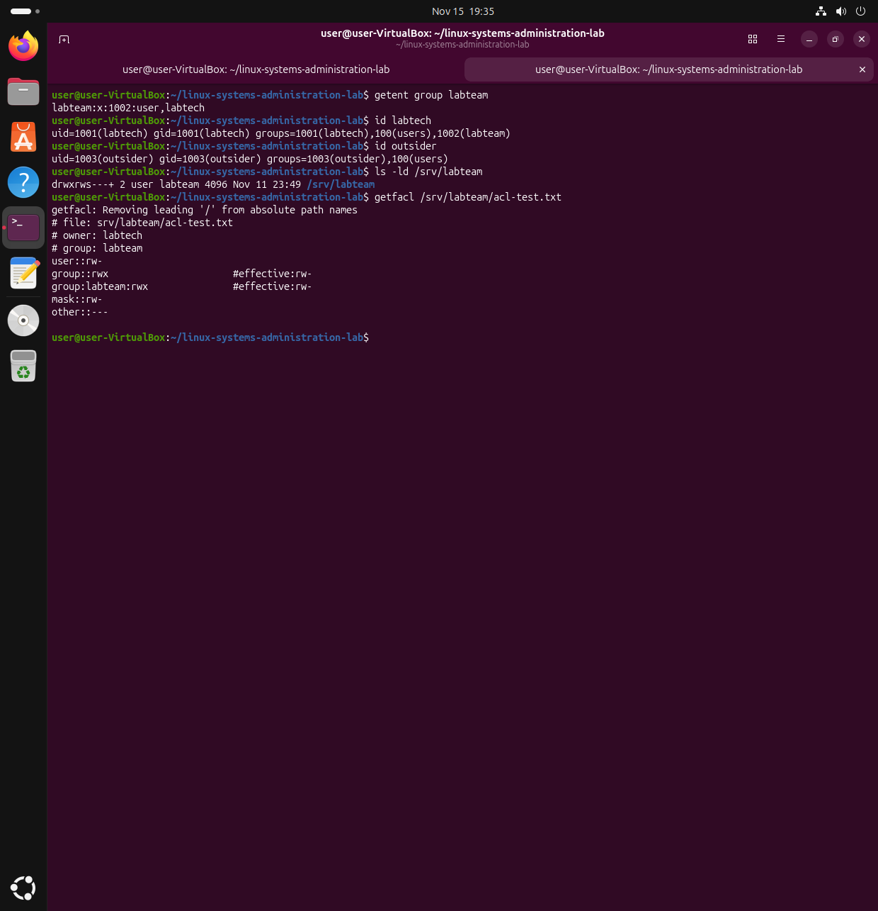
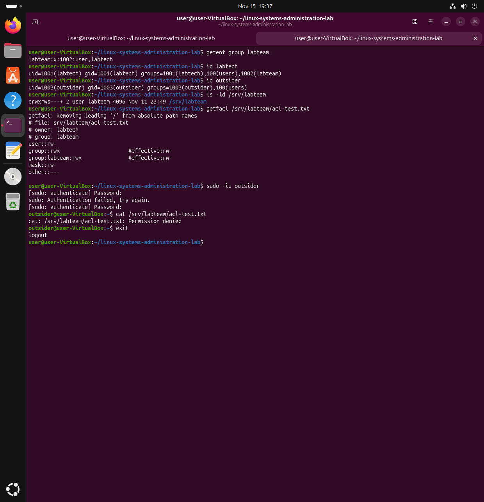
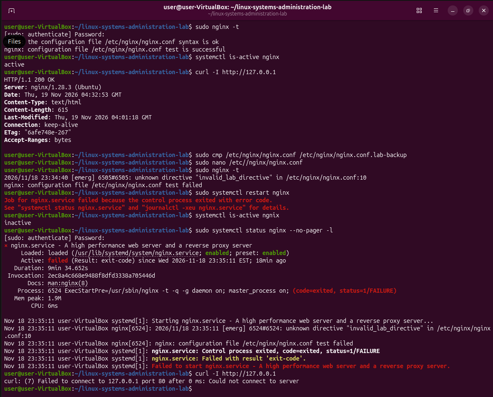
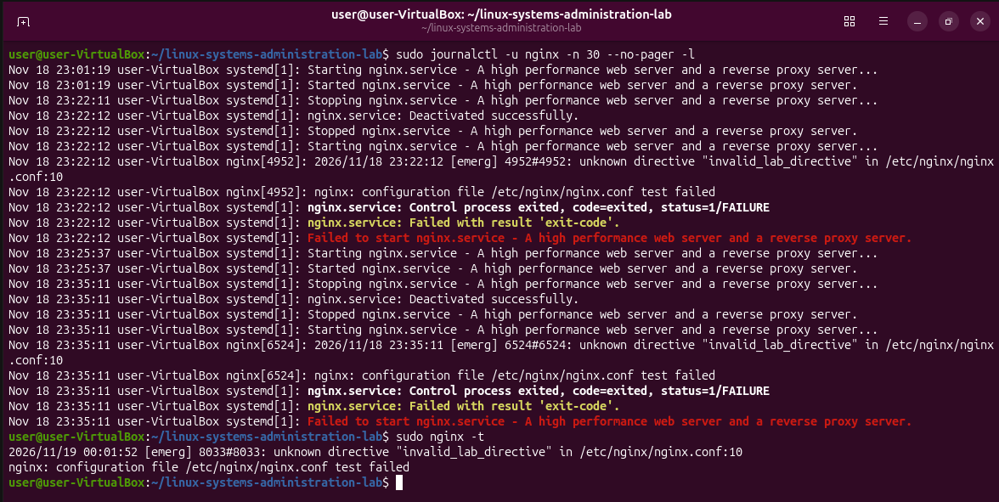
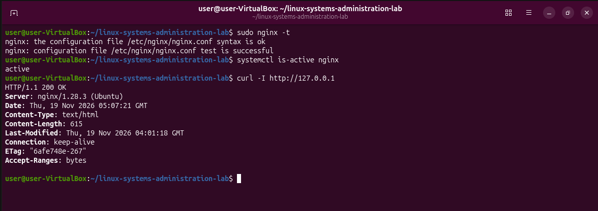

# Linux Systems Administration Lab

**A hands-on Linux administration and security project focused on user management, group-based permissions, access control lists (ACLs), and troubleshooting.**

## Project Overview

This project demonstrates practical Linux systems administration skills using Ubuntu Desktop in an Oracle VirtualBox virtual machine.

The objective is to configure secure access to shared resources, apply the principle of least privilege, and validate system behavior through hands-on testing.

This repository is part of my ongoing Cloud / Systems Engineering learning roadmap.

## Lab Environment

| Component | Configuration |
|---|---|
| Host operating system | Windows 11 |
| Virtualization platform | Oracle VirtualBox |
| Guest operating system | Ubuntu Desktop |
| Administrative account | `user` |
| Standard account | `labtech` |
| Unauthorized test account | `outsider` |
| Shared Linux group | `labteam` |
| Shared directory | `/srv/labteam` |
| Version control | Git |

## Project Objectives

1. Create and manage Linux user accounts.
2. Configure supplementary group membership.
3. Apply least-privilege access controls.
4. Manage file ownership and permissions.
5. Configure a shared directory using the setgid permission.
6. Implement default ACLs for group-based file access.
7. Test authorized and unauthorized access.
8. Troubleshoot permission and group membership issues.

## Phase 3 — Users and Permissions

### 1. User and Group Management

Configured three Linux accounts with different access requirements:

- `user` — Administrative account with sudo privileges.
- `labtech` — Standard account authorized to access shared project resources.
- `outsider` — Standard account used to test unauthorized access.

Created a supplementary group named `labteam` and assigned `user` and `labtech` as members.

The `outsider` account was intentionally excluded.

**Verification:** Both authorized accounts appeared in the `labteam` group membership records, while `outsider` did not.

### 2. Shared Directory Configuration

Created the shared directory:

`/srv/labteam`

Configured ownership and permissions using:

```bash
sudo chown user:labteam /srv/labteam
sudo chmod 2770 /srv/labteam
```

The resulting directory permissions were:

`drwxrws---`

This configuration provides:

- Full directory access to the owner.
- Full directory access to authorized group members.
- No access to unrelated users.
- Setgid group inheritance for newly created files and subdirectories.

### 3. Access Control Lists

Configured ACLs to provide group access and default permissions for new files and directories.

```bash
sudo setfacl -m g:labteam:rwx /srv/labteam
sudo setfacl -d -m g:labteam:rwx /srv/labteam
```

Verified the configuration using:

```bash
getfacl /srv/labteam
```

A newly created test file inherited effective read and write access for `labteam`.

### 4. Security Verification

The following tests were completed successfully:

| Test | Result |
|---|---|
| `labtech` creates a shared file | PASS |
| `user` reads the shared file | PASS |
| `user` modifies a group-writable file without sudo | PASS |
| New files inherit appropriate ACL permissions | PASS |
| `outsider` attempts to enter the shared directory | ACCESS DENIED |
| `outsider` attempts to read a protected file | ACCESS DENIED |

The tests demonstrate that authorized users can collaborate while unauthorized accounts are restricted.

## Troubleshooting Experience

### Incident 1 — Incorrect Ownership Command

**Problem:** Accidentally executed `chown 2770` instead of `chmod 2770`.

**Impact:** The directory owner changed to numeric UID `2770`, while the intended permissions were not applied.

**Resolution:** Restored the correct ownership using `chown`, then applied the intended permissions using `chmod`.

**Lesson:** Successful command execution does not guarantee correct configuration. Always verify the resulting system state.

### Incident 2 — Group Membership Not Active

**Problem:** The administrator account could not modify a group-writable file even though the account had been added to `labteam`.

**Root cause:** The existing terminal session had not acquired the updated supplementary group membership.

**Resolution:** Installed the missing `newgrp` utility and started a shell with `labteam` as the active group.

**Verification:** Successfully appended text to the shared file without sudo.

**Lesson:** Linux account database membership and the credentials of an already-running process are not always identical.

## Skills Demonstrated

- Linux command-line administration
- User and group management
- Least-privilege access control
- File ownership and permission management
- Setgid directories
- POSIX access control lists
- Security verification
- Root-cause troubleshooting
- Git version control
- Technical documentation

## Repository Documentation

Additional technical details are organized in the `docs/` directory.

| Document | Purpose |
|---|---|
| `users-and-groups.md` | Account and group configuration |
| `file-permissions.md` | Ownership, permissions, and setgid |
| `acl-configuration.md` | Default ACL configuration and testing |
| `troubleshooting.md` | Problems, diagnosis, and corrective actions |
| `nginx-incident-recovery.md` | Nginx outage diagnosis, root-cause analysis, and recovery |

Supporting screenshots are organized in the screenshots/ directory and provide evidence of configuration, security testing, service failures, and recovery procedures.

## Verification Evidence

The following screenshots document the configuration and security testing performed during Phase 3.

### Group Membership



### Shared Directory Permissions



### ACL Inheritance



### Unauthorized Access Prevention



## Phase 4 — Nginx Service Failure & Recovery

### Incident Summary

Simulated an Nginx web server outage caused by an invalid configuration directive. Investigated the failure using Linux service-management and logging tools, restored the original configuration, and verified successful recovery.

### Failure Evidence



### Root-Cause Analysis



### Successful Recovery



### Technical Documentation

[Read the complete Nginx incident report](docs/nginx-incident-recovery.md)

### Skills Demonstrated

- Linux service management with systemd
- Nginx configuration validation
- System log analysis and root-cause investigation
- Service outage simulation and recovery
- HTTP connectivity testing
- Technical incident documentation

**Phase 3 — Linux Users & Permissions: Completed and verified.**

## Project Status

### Completed Milestones

**Phase 3 — Linux Users & Permissions: Completed and verified.**

- Created and managed Linux user accounts and groups.
- Configured shared directory permissions and ACL inheritance.
- Verified authorized access and blocked unauthorized users.
- Documented technical procedures and captured supporting evidence.

**Phase 4 — Nginx Service Failure & Recovery: Completed and verified.**

- Installed and configured the Nginx web server.
- Reproduced a controlled outage using an invalid configuration directive.
- Diagnosed the failure using `systemctl`, `journalctl`, and `nginx -t`.
- Restored a known-good configuration backup.
- Verified successful recovery with `HTTP/1.1 200 OK`.

### Upcoming Milestones

**Phase 5 — Automated Backups & Restoration:** Not started.

**Phase 6 — System Monitoring:** Not started.

### Current Project Focus

Documenting the Nginx incident and publishing the supporting evidence to GitHub
