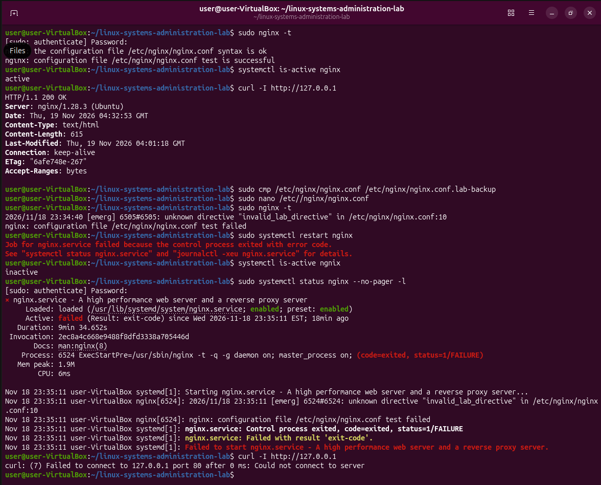
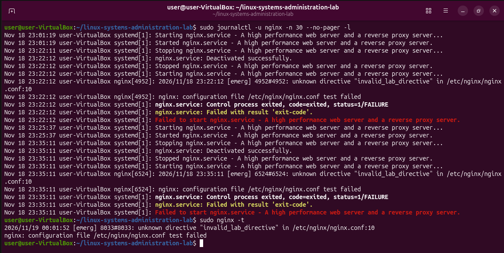
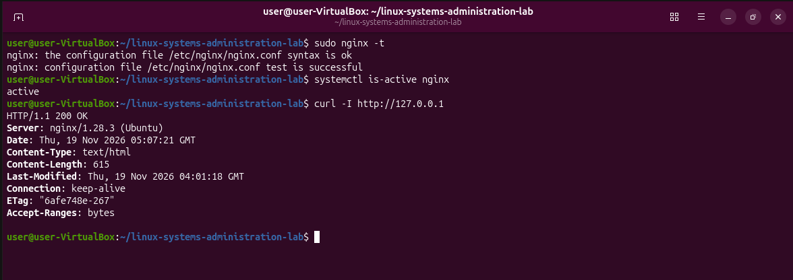

# Nginx Service Failure and Recovery

## Incident Overview

- **Environment:** Ubuntu Desktop VM running in Oracle VirtualBox
- **Service:** Nginx Web Server
- **Incident Type:** Controlled configuration failure
- **Status:** Resolved

## Objective

Reproduce a web server outage, diagnose the root cause using Linux administration tools, and restore service using a known-good configuration backup.

## Failure Simulation

Introduced the intentionally invalid directive `invalid_lab_directive on;` into `/etc/nginx/nginx.conf`.

A subsequent service restart failed, and Nginx entered the `failed` state.

HTTP connectivity testing confirmed that the web server was unavailable.

## Root Cause Analysis

Used `systemctl status`, `journalctl`, and `nginx -t` to investigate the startup failure.

The diagnostic output identified an unknown configuration directive in `/etc/nginx/nginx.conf`.

**Root cause:** Nginx could not load its configuration because it contained an unsupported directive.

## Recovery Procedure

Restored the previously saved configuration:

```bash
sudo cp -a /etc/nginx/nginx.conf.lab-backup /etc/nginx/nginx.conf
```

Validated the restored configuration:

```bash
sudo nginx -t
```

Restarted the service:

```bash
sudo systemctl restart nginx
```

Verified recovery:

```bash
systemctl is-active nginx
curl -I http://127.0.0.1
```

## Results

- Configuration validation passed.
- Nginx returned to the `active` state.
- HTTP connectivity was restored with `HTTP/1.1 200 OK`.

## Incident Evidence

### Failed Service



### Root Cause



### Successful Recovery



## Lessons Learned

1. Validate configurations before applying changes.
2. Maintain known-good configuration backups.
3. Use system logs to identify the cause of service failures.
4. Verify application availability in addition to service state.
5. Document both the failure and the recovery process.

## Final Status

**Resolved — Nginx successfully restored and HTTP connectivity verified.**
